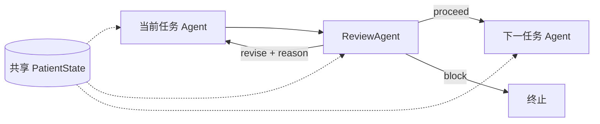

# 可配置的 Agent / Review 迭代工作流

实现位于 `src/workflow/`，导入路径为 `bpcagent.workflow`。基于上游
`9390414a308c0a07dd4a0bec1556938a8bb9fe44` 的 `BasicAgent`、`ToolRegistry`、
`Config` 和真实工具调用循环构建。PatientStateAgent 现仅保留 workflow 实现，
独立版的状态/证据保存功能已合并；旧独立版构造接口已删除。
UnitPatientStateAgent 和 PatientStateTask 的高级单位纠错接口保持不变。

## 当前流程



任务阶段默认按 PatientState → TargetSelection → DrugSelection 串行执行。
一次 Agent 完整调用是一个 **turn**，Review 调用也独立计一个 turn；模型内部多次
调用工具是同一 turn 的 `tool_step`，不是新的 workflow turn。
PatientState 的提取、证据查询、`state_check` 均在其阶段内部完成，每次重试也必须检查。
正常流程共 6 个 turn：Patient/Review、Target/Review、Drug/Review。
Meta 不执行，源码和配置只保留注释接入点；不要求其 API key，不生成 meta_result。

- Review 的 `proceed` 允许进入下一阶段，**不代表医学正确或临床批准**。
- Review 每个决定都必须带非空 `reason`。`revise` 将被拒绝的输出及 Review 的
  reason/issues/evidence_gaps 交给当前阶段的新 Agent，默认最多尝试 2 次（含首次）。
  重试期间不运行下游、不重跑已经接受的上游；耗尽返回 `revision_limit`。
- `block` 是不可恢复/安全问题的终止，不等同于普通拒绝；普通拒绝应使用 `revise`。
- 任务执行失败也必须交给 Review，可被要求重试；失败输出即使被 Review 错误批准也不能进入下游。
  Review 自身失败则终止，不递归审核 Review。
- 所有 Agent 必须读取共享状态和阶段上下文，并调用 `submit_output` 提交通过
  Pydantic 校验的结构化结果；只用文字宣称完成会失败。

## 流程定义与未来 RSI

`demo.py` **不是流程示例或流程定义**，只是离线模拟模型响应，确保无需 API 也能测试真实调度。

| 文件 | 职责 |
| --- | --- |
| `config/pipeline.jsonc` | 可编辑流程：版本、阶段、每阶段重试预算、指令、Review 指令 |
| `workflow/definition.py` | `WorkflowPlan` / `StageSpec` 校验，保护依赖关系 |
| `workflow/runner.py` | 通用阶段迭代、Agent turn 编号、Review 决策和日志 |
| `workflow/agents.py` | 角色提示、工具注册、输出验收；PatientState 内部执行 state_check |
| `workflow/demo.py` | 模拟模型（内部 tool_step），不决定阶段顺序 |

通过 `workflow.jsonc.plan_file` 选择计划。可调整阶段指令、Review 指令和各阶段尝试次数，
也可仅运行患者阶段或患者＋靶点阶段；患者→靶点→药物的依赖关系和强制 Review 不可绕过。
新增角色需先在代码注册实现和输出 schema，并扩展计划类型/依赖校验；目前不是任意 DAG 引擎。
`max_attempts: null` 沿用工作流默认上限，正整数则覆盖它。调用方模型配置仅需覆盖启用角色。

未来 RSI 可以输出候选计划，由 `WorkflowPlan.model_validate(candidate)` 校验，再创建
`AgentWorkflow(plan=candidate, ...)` 做离线对比实验。每次 run 保存计划快照；文件/外部对象
中途改变不会改变当前流程。Meta 自动生成、打分、应用计划的功能尚未接入。
当前重试会复用同一患者事实快照，只修订阶段输出/补查证据，不修改原始数据或偷看未来。

## 安装与最小例子

需要 Python 3.10+。BPCStateExtractor 提供的 `bpc_state` **0.3.0 / Schema 1.2**
已内置到 `vendor/BPCStateExtractor/`，与 BPCAgent 一次安装；数据集仍单独配置。
提取器尚未作为本项目依赖发布到包索引，需显式安装本地项目：

```bash
cd /home/u2021202188/BPCAgent
python -m venv .venv
.venv/bin/python -m pip install -e .

.venv/bin/python -m bpcagent.workflow.cli \
  --data-dir ../bpc-patient-state/dataset \
  --patient-id GENIE-DFCI-051542 \
  --start-day 159 --cutoff-day 249 \
  --workspace-root workspace
```

安装后的等价入口为 `.venv/bin/bpc-workflow`。默认 `--mode demo`：不读取模型密钥、
不调用模型服务，使用预设模型响应；患者提取、检查、工具分发、结构化校验、
Review 迭代编排和文件输出实际执行。Demo Review 仅测试控制流程，不做医学评审。

`--start-day` 只控制 `recent_observations` 的开始日期（包含边界）。
`patient_state` 保留截止日及以前的全部可用历史，避免丢失更早开始的用药和诊断。
省略时近期视图包含全部可见观察。`--cutoff-day` 是包含边界的可用时间截止点，
日期原点为患者首个 BPC 癌症确诊日。

Python 入口：

```python
from bpcagent.workflow import AgentWorkflow

workflow = AgentWorkflow(
    data_dir="../bpc-patient-state/dataset", workspace_root="workspace", mode="demo",
    top_m=5, top_k=5, max_stage_attempts=2,
)
result = workflow.run(patient_id="GENIE-DFCI-051542", cutoff_day=249, start_day=159)
print(result["finished"], result["task_dir"])
```

每次运行按启动日期（北京时间 `Asia/Shanghai`）创建日期目录，再创建独立 UUID 目录；跨午夜运行的 workflow 产物仍保留在启动日期目录中：

```text
workspace/YYYY-MM-DD/run_<uuid>/
  logs/
    console.log                  # 本次运行的 stdout/stderr、开始和结束状态
  request.json
  workflow_plan.json             # 本次运行固定的计划；默认重试预算另存于 request.json
  patient_state.json             # 原始 Schema 1.2，可与离线评估哈希匹配
  shared_patient_state.json      # 原始状态、近期视图、单位转换、完整性检查
  01_PatientStateAgent/
    patient_state_day_<cutoff>_001.json
    patient_evidence_day_<cutoff>_002.json # 可分批查询，序号递增
    context.json
    transcript.json             # 包含实际模型响应和工具结果
    output.json
  02_ReviewAgent/...
  03_TargetSelectionAgent/...    # 若首阶段被拒绝，则这里是 03_PatientStateAgent
  ...
  workflow_result.json           # 完成状态、全部阶段反馈、接受的输出
```

日期统一使用北京时间（`Asia/Shanghai`），不依赖服务器的系统时区。
Python、CLI 和 Notebook 均由 `AgentWorkflow.run()` 自动创建同样的目录结构，
控制台输出保存到本次实验的 `logs/console.log`，返回值 `log_path` 是其绝对路径。
Notebook 不再单独创建外部日志；每个 Agent 的结构化调用轨迹仍在各阶段的 `transcript.json` 中，
不重复复制到 logs。跨午夜时，本次实验的日志和产物仍在同一个启动日期目录中。

如果 workflow 抛出未预期异常，日志仍会关闭并保留，记录异常类型（不主动记录可能含密钥的异常正文）；
可从 `workflow.last_run_dir` 找到本次目录。由于 stdout/stderr 重定向影响整个进程，
并发实验应使用独立进程，不要在同一个进程的多个线程中并行调用 workflow。

独立 Basic/ReAct Agent 默认在 `workspace/YYYY-MM-DD/run_<uuid>/logs/` 新建 JSON 日志；
UnitPatientStateAgent 使用调用方指定的 `task_dir/logs/`，
以便与已有产物放在一起。PatientStateTask 的自定义任务目录命名和时区配置保持不变。
不再自动写入仓库顶层的 `log/`。旧日志、旧实验目录和 Notebook 已有输出不会自动迁移或删除；
读取新产物请使用返回的 `task_dir` / `log_path`，不要硬编码旧目录层级。

最终 `finished=true` 只表示编排完成。本版本 `scientific_tools=placeholders`，
靶点和药物候选为空，宿主也会拒绝模型绕过占位状态提交非空候选。
候选 Schema 已预留靶点方向、依据、证据引用和适用性未知状态；接入真实检索/
排序工具后，需要同时扩展宿主的候选验收条件。

结果 schema 为 `2.0`，`turns` 代替旧的 `invocations`：每项含 turn、agent、stage、attempt、
kind、reviews_turn 和 artifacts。Review 的 reviews_turn 精确指向其审核的任务 turn。
PatientState 的 artifacts 包含 state 路径及 evidence 路径列表，均相对本次 task_dir。
`stages` 保留每次尝试的任务/Review 配对；`accepted_outputs` 仅保留已通过的输出。
Python 入口统一为 `AgentWorkflow`，不再提供旧名称别名。

## 真实模型

真实模式仍使用相同工作流和占位科学工具；它验证模型驱动的编排，不代表已接通
药物推荐。配置集中在 [config/](../config/README.md)：`providers.jsonc` 定义服务商，
`models.jsonc` 定义模型和推理档位，`agents.jsonc` 为启用的 Agent 分别绑定 LLM，
在 Git 忽略的 `secrets.local.json` 中填写服务商密钥。CLI 自动读取当前目录
的 `config/workflow.jsonc`，支持 `--config` 和命令行覆盖。不会自动读取旧版 `.env`。

当前 DeepSeek 配置也支持通过环境变量提供共享密钥：

```bash
export DEEPSEEK_API_KEY='your-key'

.venv/bin/bpc-workflow --mode live \
  --data-dir ../bpc-patient-state/dataset \
  --patient-id GENIE-DFCI-051542 --cutoff-day 249
```

启用角色各自选择模型档位。Review 的 model ID 必须与每个任务 Agent 的模型都不同；
这能防止配置时无意复用相同名称，但不能识别供应商的模型别名。
当前配置使用 DeepSeek Flash low 处理三个任务、DeepSeek V4 Pro low 做 Review；Meta 配置被注释。
这些绑定可以独立修改。Python 接口通过 `agent_configs` 为启用角色分别传 `Config`，
或使用 `WorkflowConfiguration.model_configs()` 加载文件；旧 task/review/meta 参数及配置已移除。
密钥按 `openai`、`claude`、`deepseek` 官方平台和 `gateway` 路由平台四类配置，
通过路由平台调用任何模型都使用 `gateway` 的地址和密钥。
OpenAI 推理工具调用走 Responses，兼容服务商可配置 Chat Completions。
模型服务需要支持工具调用。每次角色调用为独立实例，跨角色信息由结构化上下文传递。

## 已实现与占位边界

| 模块 | 当前行为 |
| --- | --- |
| BPC Patient State | 实际调用 `BoundedPatientTool`，患者和截止点由宿主绑定 |
| state_check | 校验 Schema、时间边界、证据引用，报告缺失原因和未完成转换 |
| 单位整理 | 复用上游换算函数；PSA 的明确 ng/mL、ug/L 统一为 ng/mL；明确总/游离睾酮的 ng/dL 保留；歧义项标记待核验 |
| search、pathway_graph、graph_ranking | 占位；KEGG/PINDER/BioGRID/指南尚未加载 |
| drug_catalog、dock、ept_meet、drug_metrics | 占位；FDA 药物与计算评分尚未接入 |
| bash | 占位，不执行模型给出的 shell 命令 |
| ReviewAgent | Demo 为流程验证；Live 为独立模型复核，输出 proceed/revise/block |
| MetaAgent / rsi_evaluate | 不运行；保留类及占位工具，调用入口注释；自动实验、评分、应用尚未实现 |

单位未知时不能保证所有观测都得到统一数值。原始 `null`、`field_status` 和原始单位
保留，转换结果单独保存；`unknown` 是状态而不是混入数值列的字符串。
缺失停药日期不解释为继续服药；药物候选不触发停药、加药或换药。
现有 `UnitPatientStateAgent` 的模型纠错/沙箱实现仍可单独运行，尚未自动用于此最小流程。

所有角色看到相同患者状态哈希，工具返回独立拷贝；模型没有更新共享状态的工具。
Meta 的数据质量建议不直接更改原始 dataset 或当前患者状态。以后实现 RSI 时，
需将提案版本、评估集合、指标和实验结果保存下来，再比较是否接受改动；
Review 模型和时间隔离规则不应成为优化对象。

## 日期范围后的评估数据

未来观察是已发生的真实记录，**不放入任何 Agent 的共享 JSON**。
从内置 BPCStateExtractor 的离线入口另外导出（不暴露给任何 Agent）：

```bash
mkdir -p offline_evaluation
.venv/bin/bpc-state --data-dir ../bpc-patient-state/dataset evaluation \
  --patient-id GENIE-DFCI-051542 --cutoff-day 249 --end-day 339 \
  --output offline_evaluation/GENIE-DFCI-051542-after-249.json
```

用 `meta.input_state_sha256` 与工作流 `patient_state_sha256` 连接输入和评估文件。
当前离线导出器包含后续影像、门诊、肿瘤标志物，尚不包含用于药物 Hit@K 的
未来新用药标签。目录分离和工具绑定不是操作系统沙箱；以后接入真正 bash 时
必须限制其文件访问，不能暴露原始未来记录或离线评估目录。

## 指南和药物数据库从哪里获取

截至 2026-10-26 核对的官方入口，当前仅记录接入计划，不进行批量下载：

- [EAU 前列腺癌治疗指南](https://uroweb.org/guidelines/prostate-cancer/chapter/treatment)：
  有按疾病阶段组织的治疗章节，页面提供完整 PDF。可作为前列腺癌首个指南来源；
  存储、批量处理和分发前核对其 [使用条款](https://uroweb.org/guidelines/prostate-cancer/chapter/copyright-and-terms-of-use)。
- [NCI PDQ 医务人员版](https://www.cancer.gov/types/prostate/hp/prostate-treatment-pdq)：
  用作治疗证据综述补充；PDQ 综述不能简单当成正式用药顺序规则。
- [FDA Drugs@FDA 数据下载](https://www.fda.gov/drugs/drug-approvals-and-databases/drugsfda-data-files)：
  提供数据库表，可用于建立药物候选基础目录。适应证及限制还需要关联说明书，
  不能把“FDA 批准”解释为适用于当前患者。

指南条目应带 `source_url`、版本/发布日期、章节、疾病阶段、前置治疗条件、
分子条件、推荐强度和原文定位。不要把整份指南压成一个不带条件的药物顺序列表。
回顾性预测还要声明知识库时间策略：使用历史当时版本还是用当前知识重新评估。

## 测试与扩展入口

```bash
.venv/bin/python -m unittest discover -s tests -v
```

`tests/test_workflow.py` 使用合成 CSV 和真实提取器，覆盖正常顺序、共享状态、
未来记录不影响快照、评估数据隔离、失败通知、Review 阻断/重试、结构化提交、
占位工具和单位缺失。患者工具已内置，这些集成测试不再因未安装外部项目而跳过。
PatientStateAgent 必须在本轮保存状态，并调用 `get_patient_evidence` 保存至少一条当前快照证据；
查询只允许当前快照引用和宿主固定 cutoff。无引用时保存 status=no_evidence_refs 的空证据文件。
每次 Review 重试都重新检查这些要求，不能用上轮的完成标志跳过提取、证据保存或 state_check。
工具来源与更新方法见 [内置工具说明](../vendor/README.md)。

后续接入位置：`workflow/agents.py` 的工具注册和候选验收，
`workflow/models.py` 的输出契约，`workflow/runner.py` 的阶段编排，
`workflow/state.py` 的共享快照/质量检查。Prompt 当前在 `workflow/agents.py`，
计划入口为 `config/pipeline.jsonc` 和 `workflow/definition.py`；后续可增加版本化 Prompt 和 rubric 存储。
